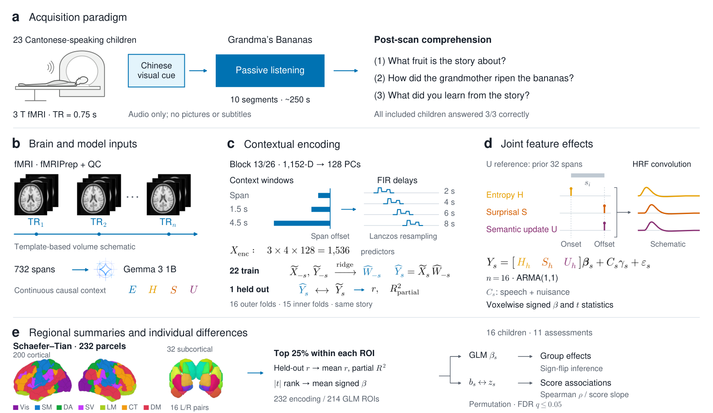
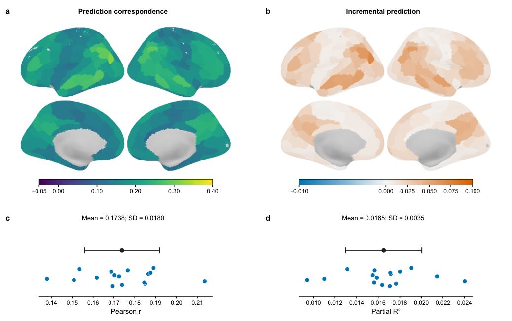
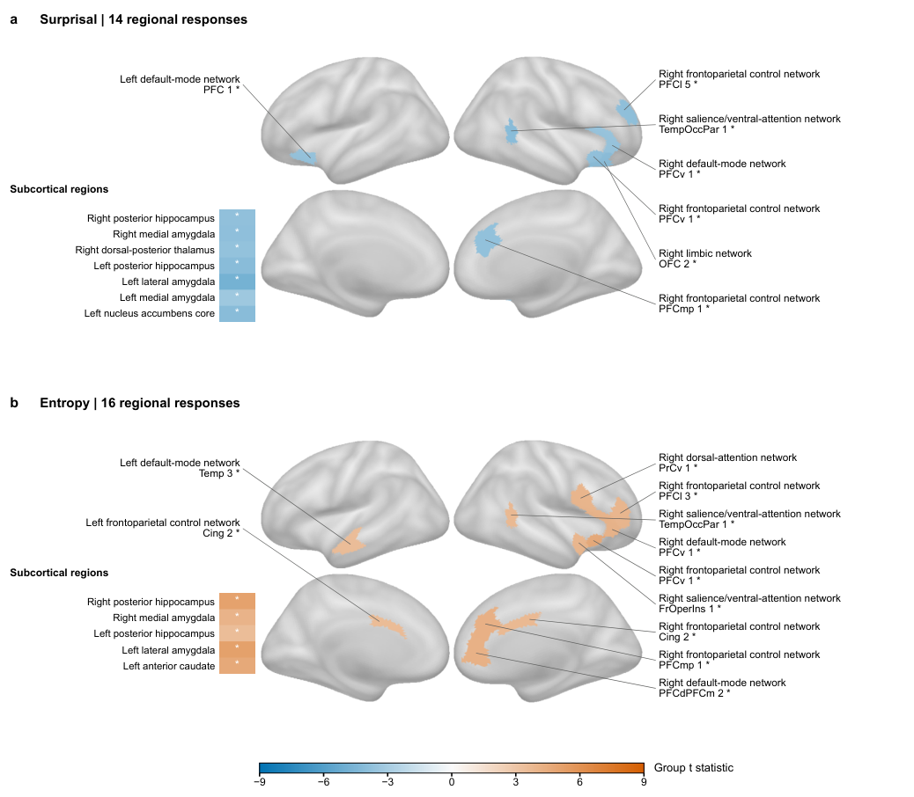
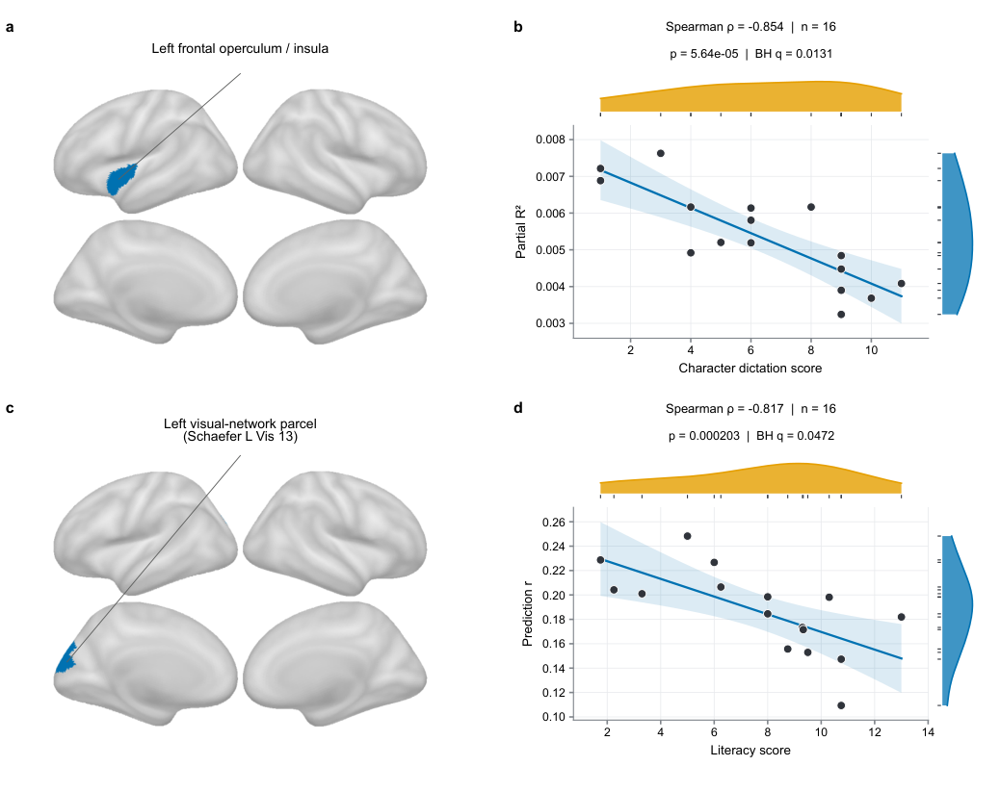
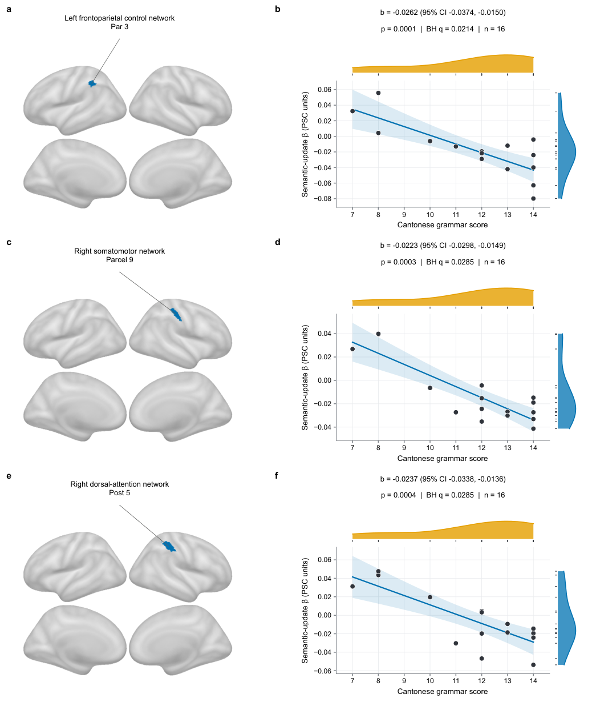
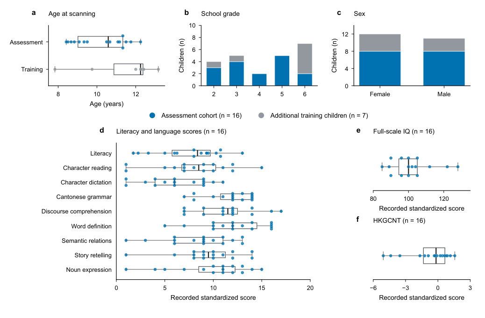

# Contextual language representations link narrative processing to language and literacy in children

**Dongyi He†, Tian Jiang†, Nizhuan Wang\*, Wai Ting Siok\***

Department of Language Science and Technology, The Hong Kong Polytechnic University, Hung Hom, Hong Kong SAR, China

† These authors contributed equally to this work.  
\* Corresponding authors: [wangnizhuan1120@gmail.com](mailto:wangnizhuan1120@gmail.com); [wai-ting.siok@polyu.edu.hk](mailto:wai-ting.siok@polyu.edu.hk)

This repository provides the preprocessing, language-feature extraction, voxelwise encoding, text-feature GLM, regional inference and figure code for the accompanying paper.

**Paper specification:** Gemma 3 1B · PC128 for encoding · Schaefer 200 + Tian S2 · within-ROI top 25% · 23 imaging participants · 16 assessment-complete participants.

## Methods overview

This study integrated naturalistic story-listening fMRI, standardized behavioral assessments and computational language modelling to examine contextual language processing in Cantonese-speaking children ([Figure 1](#paper-figures)). The imaging cohort comprised 23 children, including 16 who completed the full literacy, oral-language and cognitive assessment battery. Following preprocessing and quality assessment, BOLD responses were aligned with contextual embeddings and predictive features extracted from Gemma 3 1B. Two complementary analyses characterized the relationship between these model-derived representations and neural responses. A joint voxelwise general linear model estimated signed associations with surprisal, predictive entropy and semantic update, conditional on the other features. Contextual-embedding encoding models used nested leave-one-subject-out cross-validation to evaluate prediction of the 16 assessment-complete children's responses to the same story. Both approaches accounted for speech-related, acoustic and nuisance variation. Selected-voxel summaries were then derived within cortical and subcortical regions defined by the Schaefer–Tian parcellation. With the child as the unit of inference, permutation analyses assessed regional text-feature responses and associations of regional encoding performance and text-feature coefficients with behavioral scores. False discovery rate correction was applied across regions within each predefined family of tests.

## Paper figures

### Figure 1. Naturalistic story-listening paradigm and analysis framework



[Vector PDF](docs/figures/fig1.pdf)

### Figure 2. Contextual embeddings captured spatially structured story responses



[Vector PDF](docs/figures/fig2.pdf)

### Figure 3. Surprisal and entropy mapped signed regional response profiles



[Vector PDF](docs/figures/fig3.pdf)

### Figure 4. Regional encoding performance was associated with literacy scores



[Vector PDF](docs/figures/fig4.pdf)

### Figure 5. Semantic-update coefficients were associated with grammar scores



[Vector PDF](docs/figures/fig5.pdf)

### Supplementary Figure S1. Cohort and assessment distributions



[Vector PDF](docs/figures/figS1.pdf)

Figures are available in PNG and vector PDF. Data-driven plotting scripts are provided for Figures 2–5 and S1.

## Repository contents

| Path | Contents |
| --- | --- |
| `code/preprocessing/` | fMRIPrep 25.2.7 launcher, selected-run manifest and length/motion/tSNR summary |
| `code/features/` | Causal Gemma 3 1B contextual embeddings |
| `code/encoding/` | PC128, multiscale Lanczos/FIR design, nested LOSO ridge, regional metrics and exact Spearman inference |
| `code/glm/` | Three scalar features, speech/nuisance design, AFNI first-level GLM, ROI aggregation and second-level inference |
| `code/figures/` | Figure-data export, cortical surface rendering, association plots and cohort plots |
| `code/atlas/`, `assets/` | Verified atlas preparation and public visualization assets |
| `results/` | The paper's regional summary statistics, including all tested ROIs |
| `docs/figures/` | Final manuscript figures in PDF and PNG |
| `data/templates/` | Header-only input templates |
| `config/` | Fixed paper specification and assessment labels |

## Installation

Use Python 3.10 on Linux or WSL. Docker is required for fMRIPrep; AFNI (`3dDeconvolve`, `3dREMLfit`, `3dinfo`) and FFmpeg are required for the text GLM and audio controls.

```bash
python3.10 -m venv .venv
source .venv/bin/activate
python -m pip install -r requirements.txt
python -m pip install torch==2.8.0 --index-url https://download.pytorch.org/whl/cpu
python -m pip install -r requirements-models.txt
```

The model is `google/gemma-3-1b-pt`, pinned to revision `fcf18a2a879aab110ca39f8bffbccd5d49d8eb29`. Download this checkpoint through your own authorized Hugging Face account and supply its local directory. No model weights or credentials are distributed here. Use your own FreeSurfer license for fMRIPrep.

## Inputs and run order

Run commands from the repository root. Set these paths before running:

```bash
export PAPER_DATASET="$PWD/data/dataset"  # contains bids/
export PAPER_INPUTS="$PWD/data/inputs"
export PAPER_OUTPUT="$PWD/outputs"
export PAPER_CACHE="$HOME/.cache/narrative-paper"
export MODEL_DIR="/path/to/the/pinned/gemma-checkpoint"
export FS_LICENSE="/path/to/license.txt"
export PAPER_AUDIO="$PAPER_INPUTS/story.mp3"  # original recording; keep its format
```

Populate the [input templates](data/templates/) with the study data; see [input formats](docs/inputs.md). `participants.tsv` identifies the 23 children and the 16 outer-fold evaluation participants. Preserve ascending subject order and the original selected runs. The supplied 732-span segmentation is fixed across analyses, including the original token counts used as speech controls.

```bash
# 1. Preprocess the selected cohort (five participants share native scheduling).
bash code/preprocessing/run_fmriprep.sh --dry-run
bash code/preprocessing/run_fmriprep.sh

# Review the fMRIPrep HTML reports for normalization, coregistration,
# coverage and artefacts, then resolve one QC-selected story run per child.
python code/preprocessing/build_run_manifest.py
python code/preprocessing/summarize_qc.py

# 2. Extract the exact-prefix embeddings and the three scalar features.
python code/features/extract_embedding.py --model-dir "$MODEL_DIR"
python code/glm/extract_scalar.py --checkpoint "$MODEL_DIR"

# 3. Contextual encoding: fixed PC128, 3 context scales, 4 FIR delays.
python code/encoding/build_features.py
python code/encoding/prepare_bold.py
python code/encoding/fit_encoding.py --jobs 2
python code/encoding/roi_analysis.py

# 4. Joint scalar GLM, top-25% regional summaries and second-level inference.
python code/glm/first_level.py --jobs 1 --threads 4
python code/glm/aggregate.py
python code/glm/second_level.py

# 5. Export the resulting plot inputs and draw the paper figures.
python code/figures/render_all.py
```

The scripts retain the paper's frame grid, frame flags, nuisance regressors, within-child voxel rankings, nested LOSO split and ROI-wise BH-FDR families. `--jobs` changes computing concurrency, not the cross-validation design. Preprocessing and model fitting require the study inputs and substantial compute; numerical checks use small synthetic examples.

## Data and numerical checks

The data that support the findings of this study are available from the corresponding author upon reasonable request.

The repository includes the paper's aggregate regional tables (12,808 tests and 232 encoding ROI summaries). Participant-level data follow the manuscript’s stated access route. Model weights are downloaded through the user’s authorized account; credentials are never distributed with this repository. Numerical checks and packaging verification are described in [reproducibility.md](docs/reproducibility.md):

```bash
python code/encoding/test_numerics.py
python code/glm/test_numerics.py
python -m unittest discover -s tests -v
```

All 7,704 text-GLM permutation p values and BH q values reproduced the original results exactly; both 16 × 232 encoding metric arrays also matched exactly. Full preprocessing and model fitting require the original inputs. See [third-party notices](THIRD_PARTY_NOTICES.md) for bundled reference assets and software citations. GitHub citation metadata is in [CITATION.cff](CITATION.cff).


## Acknowledgment

This work was supported by Brain Science and Brain-like Intelligence Technology - National Science and Technology Major Project (2021ZD0200500), The Hong Kong Polytechnic University Departmental Collaborative Research Fund (Project ID: P0056428), an internal grant from The Hong Kong Polytechnic University (Project ID: P0048377), The Hong Kong Polytechnic University Collaborative Research with World-leading Research Groups Fund (Project ID: P0058097) and Research Grants Council Collaborative Research Fund (Project ID: C5033-24G). The authors thank the University Research Facility in Behavioral and Systems Neuroscience (UBSN), The Hong Kong Polytechnic University, for technical and facility support. The authors thank all participants for their time and contribution to this study.
